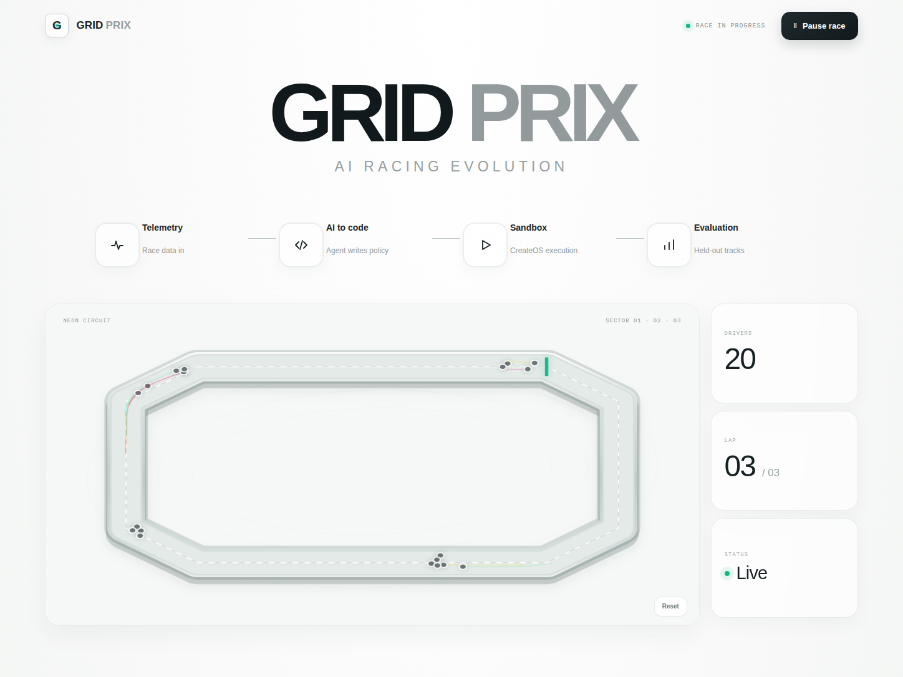
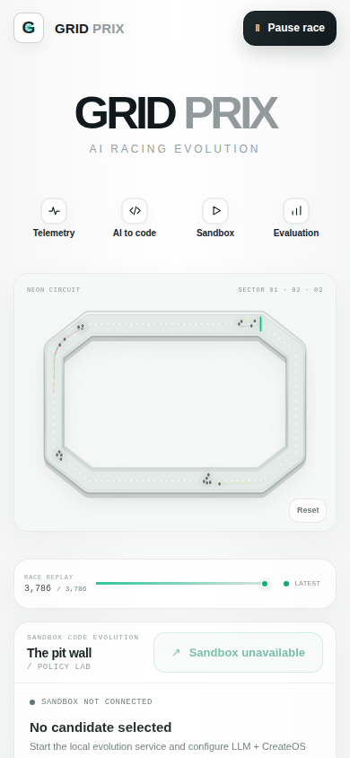

# GRID PRIX

GRID PRIX is a deterministic, Tron-inspired AI racing championship demo for
the CreateOS × Stripe Projects Hackathon. Twenty algorithmic drivers race for
ten teams in a 2D Canvas arena. Completed races feed an optional LLM policy
evolution service that generates Python candidates, executes them in real
CreateOS Sandboxes, and adopts a candidate only when it beats the baseline on
held-out telemetry.

**Public repository:** [github.com/santleme/grid-prix](https://github.com/santleme/grid-prix)

## Screenshots

| Desktop | Mobile |
| --- | --- |
|  |  |

The UI is a local deterministic race; it is not a live Groq or Sandbox run.
The recorded seed-2026 evolution results are identified separately in the
interface and submission notes.

## Run the demo

Requirements: Node.js 20+, Python 3.10+, and npm.

```sh
npm install
python3 -m venv .venv
.venv/bin/python -m pip install -r requirements.txt
npm run dev
```

Open the Vite URL (usually <http://localhost:5173>). The deterministic race,
leaderboard, telemetry, replay, team economy, and upgrades work without API
credentials. The LLM/Sandbox evolution control stays unavailable until its
server-side credentials are configured.

To enable real policy evolution, configure Groq in the ignored `.env` (Groq is
the default provider; never commit or paste secrets into source or chat):

```sh
GROQ_API_KEY=…
# Optional; defaults to openai/gpt-oss-20b and https://api.groq.com/openai/v1
GROQ_MODEL=openai/gpt-oss-20b
GROQ_BASE_URL=https://api.groq.com/openai/v1
# Optional local API bearer token:
GRID_PRIX_EVOLVE_TOKEN=…
```

OpenAI remains an optional fallback: if `GROQ_API_KEY` is absent, set both
`OPENAI_API_KEY` and `OPENAI_MODEL` (and optionally `OPENAI_BASE_URL`). Use free
Groq quota or confirm any applicable charge before a real inference run. If
CreateOS is configured through Stripe Projects, run `stripe projects env --pull`.
GRID PRIX reads its generated `CREATEOS_PROJECT_API_KEY` directly; the Sandbox
SDK uses its documented API endpoint by default. The ignored `.env` is loaded
by Python; Vite reads only the optional proxy token server-side.

Each evolution run requests a policy independently for each of the 20 drivers,
sequentially applies a conservative Groq token/RPM budget, then benchmarks
baselines and candidates in one reused CreateOS Sandbox. Per-driver code
history and cumulative inference usage are stored in ignored
`.grid_prix/driver-policies.json`.

Start the backend in one terminal and Vite in another:

```sh
npm run dev:evolution
npm run dev
```

The backend binds only to `127.0.0.1:8787`; Vite proxies requests from the UI.
Each sandbox uses the CreateOS `s-1vcpu-1gb` shape, a 30-second policy
execution timeout, and a deny-by-default egress allowlist. See
[`docs/policy-evolution.md`](docs/policy-evolution.md) for the API, benchmark,
and safety contract and [`docs/stripe-projects.md`](docs/stripe-projects.md)
for CreateOS setup through Stripe Projects.

## Verify

```sh
npm run build
npm test
npm run test:python
```

Live LLM/CreateOS calls require valid credentials and are intentionally not
simulated by tests. No paid services are provisioned by the application.

## Production container

`Dockerfile` builds the Vite UI and serves it with the Python backend on the
same HTTP origin. In a hosted deployment, GET status/history endpoints are
read-only and public evolution POSTs remain denied; this prevents an
unauthenticated visitor from consuming model quota or Sandbox executions.
Configure provider credentials only through the host's secret environment
manager. The CreateOS upload package includes the compiled UI in
`grid_prix/static`; after changing frontend source, refresh it with
`npm run build:production`. Do not enable anonymous evolution requests.

## Hackathon delivery status

This repository contains the race simulator, optional evolution backend, and
the screenshots above. See [`docs/submission-readiness.md`](docs/submission-readiness.md)
for verified publication/deployment links and any outstanding delivery steps.
